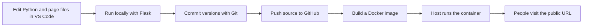

# Python Number Calculator

A beginner Python web application built with Flask. It adds, subtracts, or multiplies two numbers. Subtraction displays an error if Number A is smaller than Number B.

## 1. Open the project in VS Code

Download and unzip the project, then in VS Code choose **File → Open Folder** and select `number-calculator-python`. The main files are:

| File | What it does |
| --- | --- |
| `app.py` | Python code: receives the form, validates input, calculates, and returns a page. |
| `templates/index.html` | The page structure and input form. Flask fills in the result. |
| `static/style.css` | The page's appearance. |
| `requirements.txt` | The Python add-on packages the app needs. |
| `Dockerfile` | Instructions for packaging the app and its environment into a container image. |
| `compose.yaml` | A short command recipe for building and running the container locally. |
| `.gitignore` | Keeps local-only files such as the virtual environment out of Git. |

## 2. Run it locally (without Docker)

Install Python 3.10 or newer. In VS Code, choose **Terminal → New Terminal**. Make sure the terminal is in this project folder, then run these PowerShell commands:

```powershell
py -m venv .venv
.\.venv\Scripts\Activate.ps1
python -m pip install -r requirements.txt
python app.py
```

If PowerShell says running scripts is disabled when activating the virtual environment, use this command in that terminal and activate again:

```powershell
Set-ExecutionPolicy -Scope Process -ExecutionPolicy Bypass
```

Open `http://127.0.0.1:5000` in Chrome. Keep the terminal running while you use the app. Press **Ctrl+C** in the terminal to stop it.

The virtual environment (`.venv`) is a private place for this project's Python packages. `requirements.txt` is the list that lets another computer install the same kinds of packages.

## 3. Learn the Git and GitHub steps

Install Git, create a GitHub account, and open PowerShell in this folder. Run:

```powershell
git init
git add .
git commit -m "Create Python calculator"
git branch -M main
```

On GitHub, create a new empty repository named `number-calculator-python`. Then connect and upload it (replace `YOUR-USERNAME`):

```powershell
git remote add origin https://github.com/YOUR-USERNAME/number-calculator-python.git
git push -u origin main
```

Git stores a history of snapshots on your computer; GitHub stores a remote copy. For future changes, the everyday cycle is:

```powershell
git status
git add .
git commit -m "Describe the change"
git push
```

## 4. Package and run it with Docker

Docker packages the app together with the environment it needs. Install Docker Desktop, start it, then use the VS Code terminal in this folder:

```powershell
docker compose up --build
```

Open `http://localhost:8000` in Chrome. The first run builds an image from `Dockerfile`; the running container is the live app process. Stop it with **Ctrl+C**. To remove the stopped container, run:

```powershell
docker compose down
```

## 5. Understand the deployment path



The `Dockerfile` uses Gunicorn, a production web server, rather than Flask's built-in development server. `compose.yaml` helps you run that same container locally. GitHub holds the source code; a hosting service runs the container and gives it a public URL.

### DevOps topics, in learning order

1. **Application:** Python, Flask, HTML, CSS, and handling form input.
2. **Source control:** Git commits, branches, and GitHub remotes.
3. **Dependencies:** virtual environments and `requirements.txt`.
4. **Packaging:** Docker images and containers.
5. **Automation (CI):** a GitHub Actions workflow can install dependencies and run checks whenever you push. This project is ready to add that next.
6. **Deployment (CD):** connect the GitHub repository or container image to a hosting service. The host runs the container and provides a public web address.
7. **Operations:** environment variables, logs, health checks, monitoring, and updating/restarting the deployed app.

This project includes the app, Git ignore rules, Docker packaging, and local container running. A public deployment needs a hosting provider account and configuration; those depend on which provider you choose.
